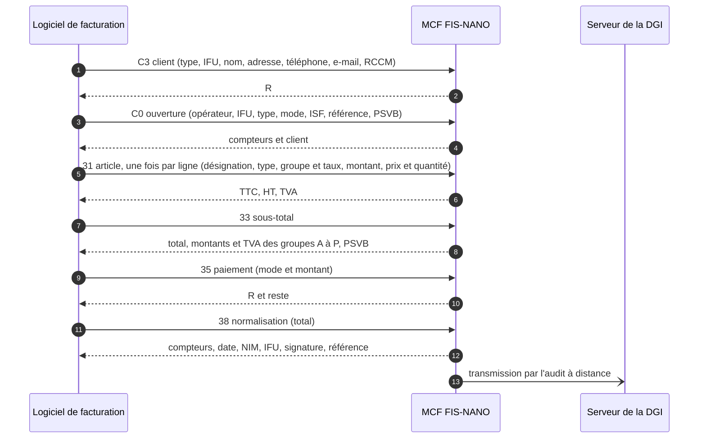

# mcf-protocole-bf

**Le protocole série du module de contrôle de facturation (MCF) du SECeF burkinabè, établi sur un Datamega FIS-NANO.**

[](https://github.com/san-kofa569/mcf-protocole-bf/actions/workflows/tests.yml)


Un logiciel de facturation d'entreprise (SFE) burkinabè doit faire certifier chaque facture par un MCF, relié en USB.
Le protocole officiel n'est pas public. Ce dépôt l'établit par essais sur un **Datamega FIS-NANO** relié à
l'environnement de test de la DGI : chaque fait dit d'où il vient (appareil, code tiers public, texte officiel).

> **État au 2026-10-28 : cycle complet prouvé** — vente, annulation et avoir certifiés sur l'environnement de test de la DGI.
> Référence complète : [`docs/REFERENCE_PROTOCOLE.md`](docs/REFERENCE_PROTOCOLE.md).

**Sommaire** — [Le cycle](#le-cycle) · [Démarrage rapide](#démarrage-rapide) · [Ce qui reste ouvert](#ce-qui-reste-ouvert) ·
[Structure](#structure) · [Sources](#sources-et-certitude) · [Règles](#données-et-règles-dessai) · [Avertissement](#avertissement)

## Le cycle



| Commande | Données (exemple prouvé) | Réponse |
|---|---|---|
| **C3** client | `PP,CLIENT TEST,,,70123456,client@example.com,` — 7 champs : type, IFU, nom, adresse, tél., e-mail, RCCM | `R` |
| **C0** ouverture | `1,Essai,{IFU},FV,TTC,ISF-ESSAI,ESSAI-0008,A` — le **PSVB** (8e champ) est obligatoire | `1,3,` + client |
| **31** article | `ARTICLE TEST⇥LOCBIE,B18.0%100.00⇥100.00*1` — type, groupe et taux, montant ; prix × quantité | `100.0,84.75,15.25,0.0` |
| **33** sous-total | aucune | 35 champs : total `102.0`, 16 montants, 16 TVA, PSVB `2.0`, … |
| **35** paiement | `E102.00` — mode (`E`, `M`, `V`, `C`, `D` ; `A` à crédit) et montant | `R0` ; reste dû en négatif : `R-114.2` |
| **38** normalisation | `102.00` — le total du 33, **seul** | 8 champs : compteurs, `FV`, date, NIM, IFU, signature (24 car.), référence |
| **38** annulation | `C`, après le 35 | `E:ANNULEE` — la facture n'est pas comptée |
| **C0** avoir | `1,Essai,{IFU},FA,COR,{NIM}-1-4,TTC,ISF-ESSAI,AVOIR-0001,A` — référence = identifiant de l'appareil et compteur total de la facture d'origine | `1,5,` + client, puis le cycle d'une vente |

Trame de la famille Datecs : `01 LEN SEQ CMD DONNÉES 05 BCC 03`, réponse `… 04 STATUT 05 BCC 03`, 115200 8N1.
Le protocole est celui de la famille du « PROTOCOLE MCF-SFE v1.0 » de la DGI de la RDC ; le Burkina y ajoute le PSVB
(prélèvement sur les ventes de biens) et réduit le 38 à une seule donnée.

## Démarrage rapide

Sans appareil : les tests et le jumeau du MCF, qui rend ce qui a été observé.

```bash
python3 -m pip install pyserial==3.5 pytest
python3 -m pytest -q                                              # tests
python3 -m appareil.recherche_article --liste --grille quantite   # affiche une grille, n'envoie rien
python3 -m appareil.recherche_article --jumeau --grille quantite  # la joue contre le jumeau
python3 -m appareil.cycle --scenario deux --fn ESSAI-0001 --jumeau  # une facture entière contre le jumeau
```

Avec l'appareil (USB CDC, `/dev/ttyACM0`, application fiscale au premier plan) :

```bash
python3 appareil/trame.py /dev/ttyACM0 20 C1 --simulation      # affiche la trame, n'envoie rien
export MCF_IFU=                                                 # suivi de l'IFU de l'appareil (9 caractères)
python3 appareil/trame.py /dev/ttyACM0 27 C0 "$(cat appareil/essais/sondes/c0_facture_8_psvb.txt)"
```

`{IFU}` dans une charge utile est remplacé par `MCF_IFU` ; sans cette variable valide, rien n'est envoyé.

## Ce qui reste ouvert

Prouvés depuis la première facture : plusieurs lignes et groupes, PSVB sur toutes les lignes (`D` = 0 %), mode HT
(la ligne porte son montant TTC et le prix HT), six modes de paiement (`E`, `M`, `V`, `C`, `D`, et `A` pour une vente à
crédit) et paiement en plusieurs fois, types `LOCBIE`, `LOCSER`, `IMPBIE`, `IMPSER`, virgule échappée `^x2c;`,
annulation (`38 C`), avoir de correction. Restent :

- **Code QR** burkinabè : « au format défini par l'Administration », non publié ; le reçu de l'appareil n'en montre pas.
- Remises (prix d'origine et motif), taxe spécifique (`;T…`), catégories PSVB B et C.
- Natures d'avoir `RAN`, `RAM`, `RRR` ; factures d'acompte et d'exportation (`FT`, `EV`, `ET`, `EA`).

> ⚠ L'appareil **ne contrôle pas les paiements** : il accepte un montant négatif et certifie une facture non soldée.
> Le logiciel de facturation doit refuser lui-même tout paiement nul ou négatif, et ne lancer le 38 qu'après un `R0`
> (c'est ce que fait [`appareil/cycle.py`](appareil/cycle.py), client de référence du cycle).

## Structure

| Dossier | Contenu |
|---|---|
| [`docs/`](docs) | [référence du protocole](docs/REFERENCE_PROTOCOLE.md), plan d'essais, logiciels tiers consultés |
| [`recherche/`](recherche) | notes datées : hypothèses, sources, déroulé des essais trame par trame |
| [`appareil/`](appareil) | `trame.py` (une trame, lecture de la réponse) ; grilles d'essai bornées ; `essais/` charges utiles |
| [`simulateur/`](simulateur) | jumeau du MCF, pour éprouver un client sans l'appareil |
| [`tests/`](tests) | tests (`python3 -m pytest -q`) |
| [`officiel/`](officiel) | textes publics de la DGI du Burkina, empreintes dans `EMPREINTES.sha256` |

## Sources et certitude

Chaque point de la référence porte sa source : ✅ prouvé sur l'appareil · 📖 lu dans un code tiers public ·
📜 texte officiel de la DGI · 🔍 hypothèse · ❓ inconnu.

- Textes de la DGI du Burkina (notes 2025-0885, 0887, 0889, arrêtés FEC) : [`officiel/`](officiel).
- Code public des pays voisins (Bénin, RDC), lu et non exécuté : empreintes dans [`docs/EXTERNE.md`](docs/EXTERNE.md)
  et dans les notes de [`recherche/`](recherche).

## Données et règles d'essai

- Aucune donnée réelle : l'IFU s'écrit `{IFU}`, le NIM `{NIM}` ; clients, téléphones et e-mails sont fictifs ; l'ISF
  des essais, valeur libre non attribuée par la DGI, s'écrit `ISF-ESSAI`. Les captures brutes ne sont pas publiées.
- Une commande à la fois vers le MCF, ou une grille bornée (une trame toutes les 3 s, arrêt au premier message
  nouveau), jouée d'abord sur le jumeau.
- Aucun geste irréversible sur l'appareil : ni activation, ni personnalisation, ni réinitialisation, ni mise à jour.

## Avertissement

Projet indépendant, sans lien avec la DGI ni avec Datamega. Le protocole est établi par observation d'un appareil en
mode Test : il peut différer d'un micrologiciel à l'autre (celui des essais : `V1.1.58_BF`). Un logiciel de facturation
doit être homologué par la DGI avant tout usage réel ; ce dépôt n'en tient pas lieu.

Les corrections et observations sont bienvenues en *issue*, avec des trames anonymisées (`{IFU}`, `{NIM}`).
